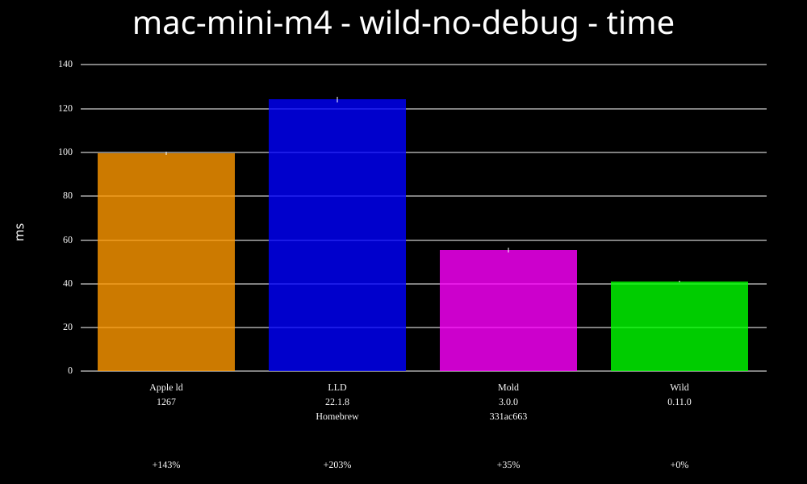
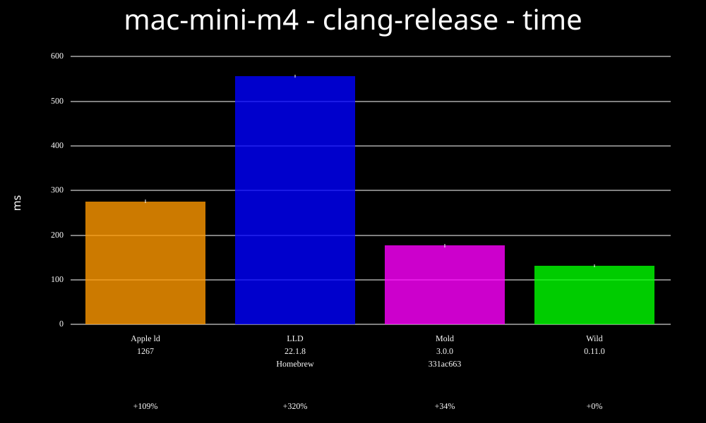
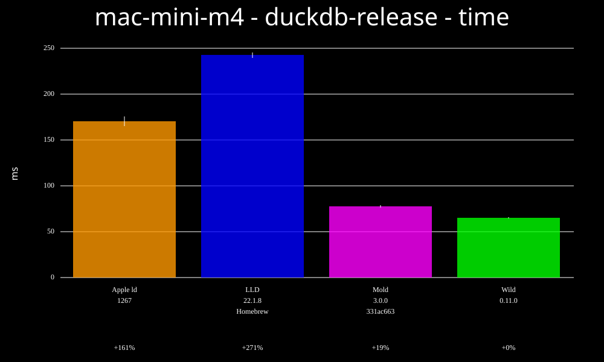
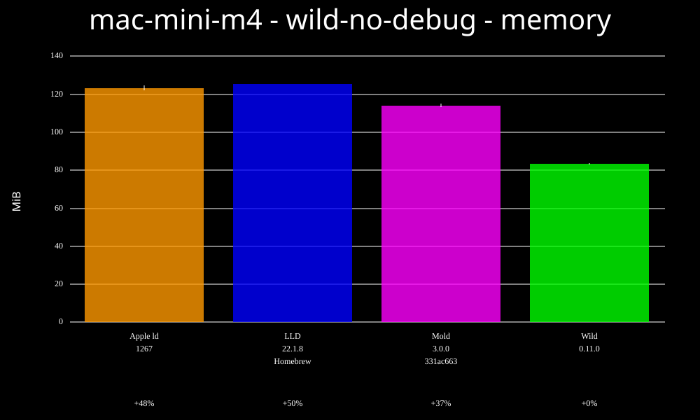
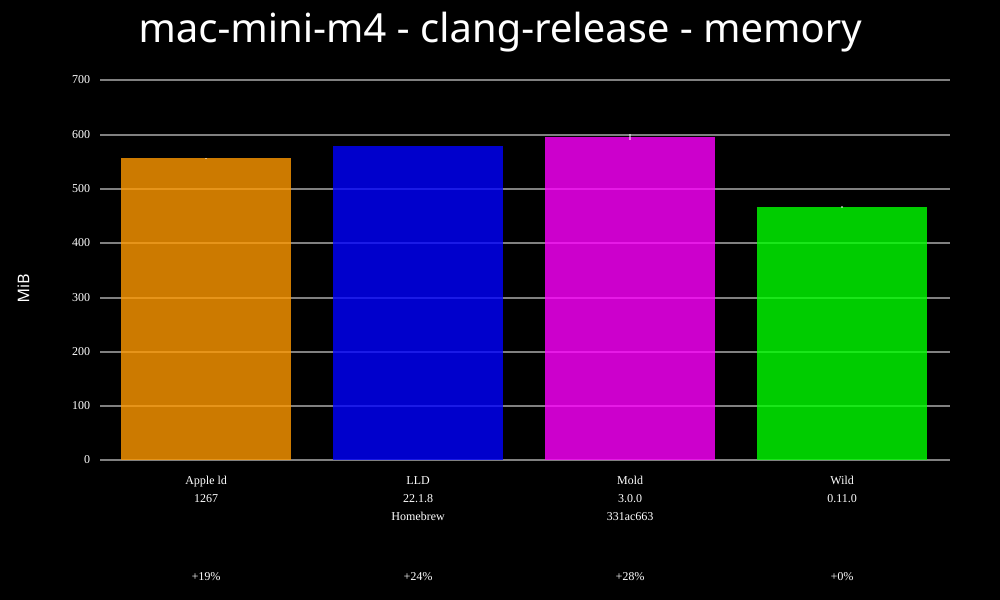
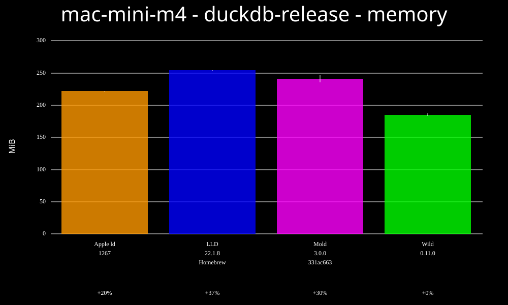

## Time

Here are a few benchmarks run on an M4 Mac Mini. It has 4 performance cores and 16 GiB of RAM.

There are various features that Wild for Mac doesn't yet support. We've tried, where possible to
work around these to make the benchmarks as fair as we can:

* Debug info: Removed all debug info from the input files.
* function/data starts: Added -no_function_starts and -no_data_starts flags to Apple and LLD flags
  to avoid generating these sections.
* String merging: Added --no-deduplicate-strings and -no-deduplicate-symbol-strings to lld to avoid
  string merging (but the apple linker doesn't support these flags).
* Optimisation hints: Removed these from the input object files.

There are almost certainly other things that we can't control for, so these results should be seen
as very preliminary.

### wild-no-debug - time

### clang-release - time

### duckdb-release - time

## Memory

### wild-no-debug - memory

### clang-release - memory

### duckdb-release - memory

