## Time

This page has benchmarks for linking Wasm on a AMD Ryzen 9 9955HX 16-Core (32 thread) processor with
92GiB of RAM.

Wild's Wasm support doesn't yet handle debug info, so all these benchmarks were built without
explicit debug info, although a small amount of debug info might be present from precompiled
libraries.

### ripgrep-wasm - time
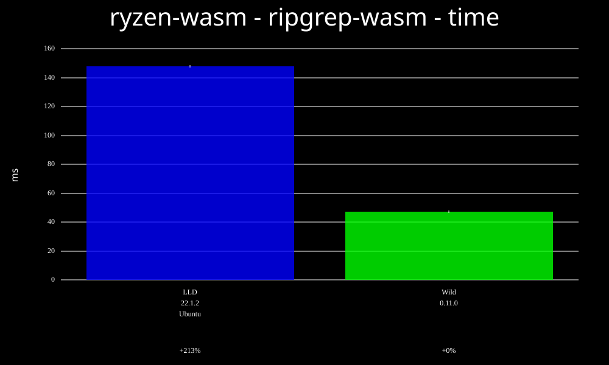

### spidermonkey-wasm - time
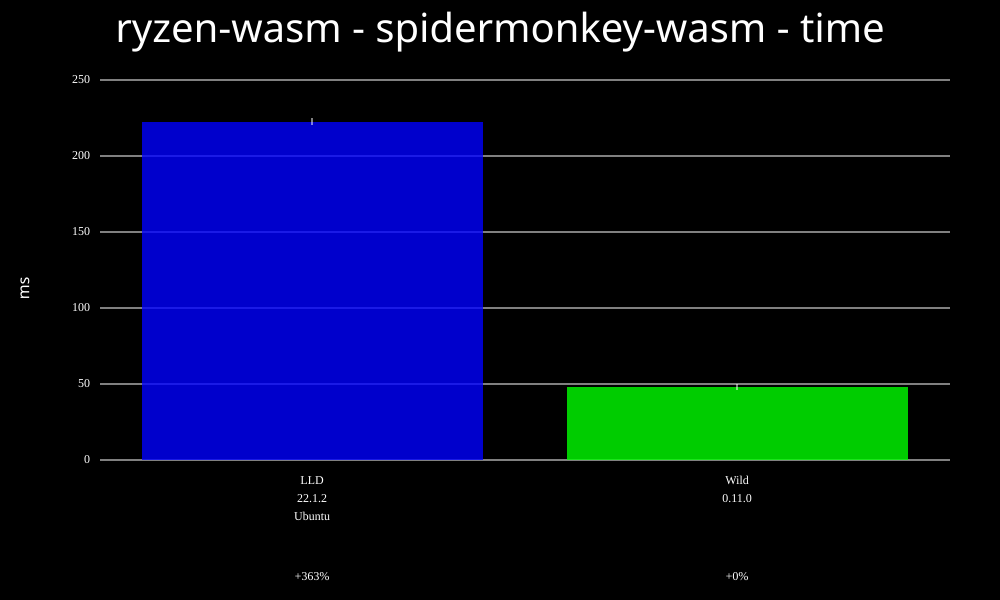

### wild-release-wasm - time
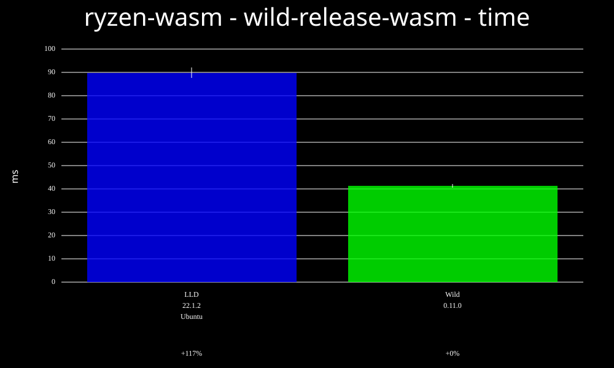

### cruby-wasm - time
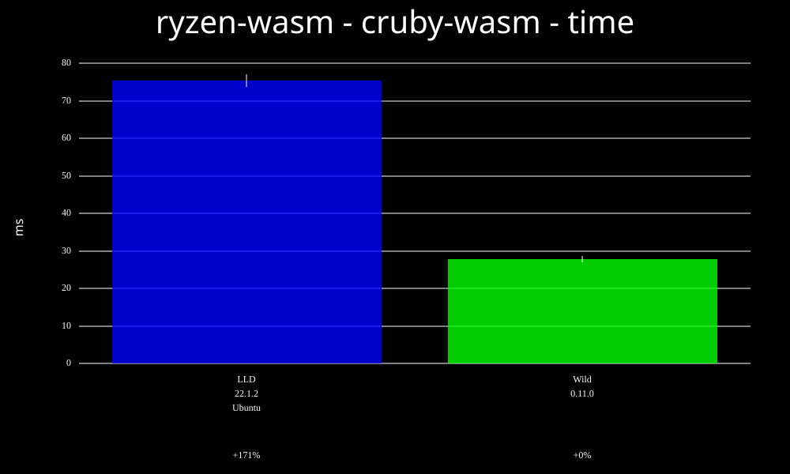

### cpython-wasm - time
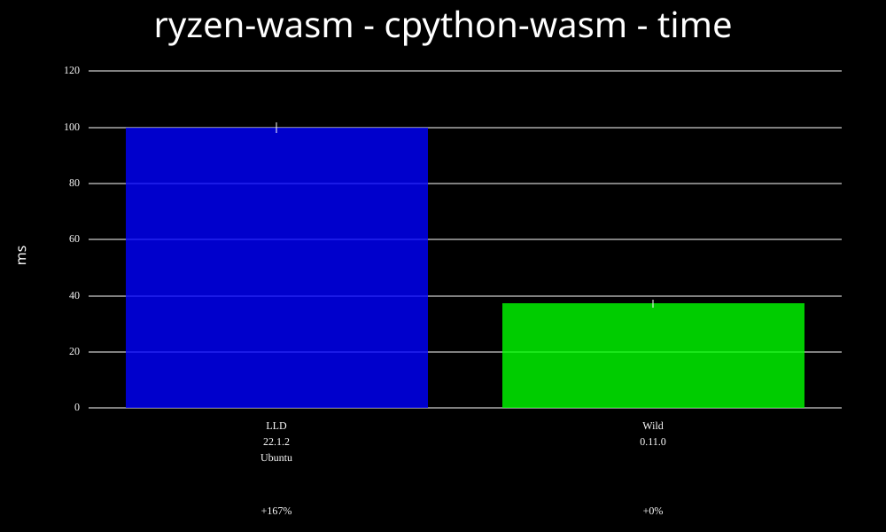

### sqlite-wasm - time
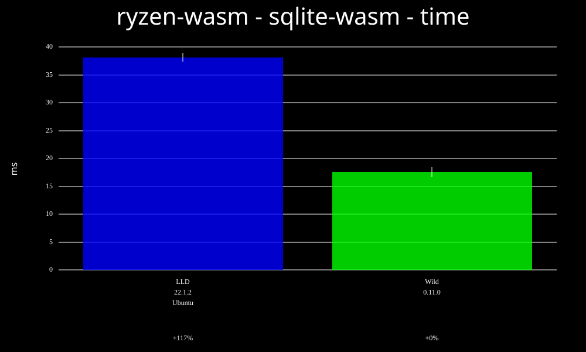

### spidermonkey-wasm.threads - time
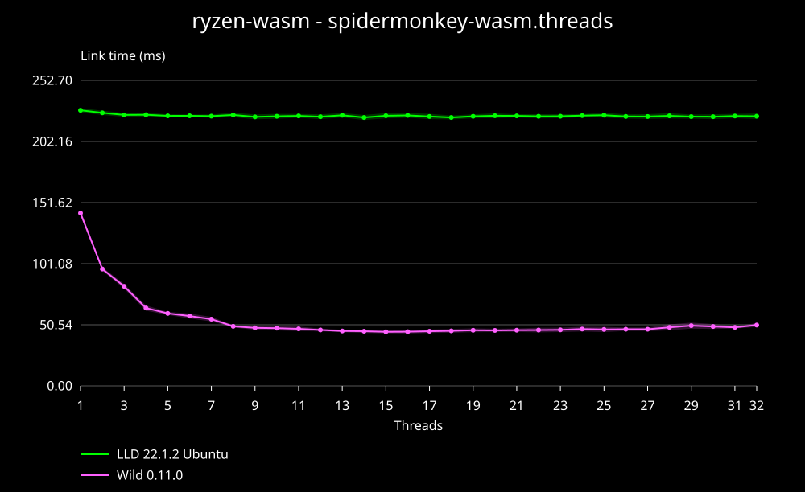

## Memory

### ripgrep-wasm - memory
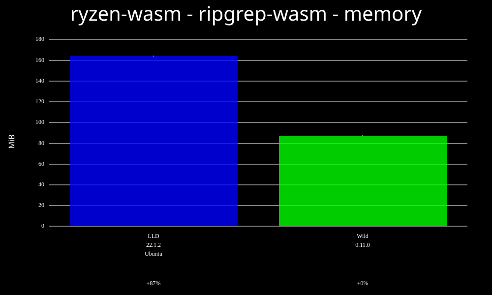

### spidermonkey-wasm - memory
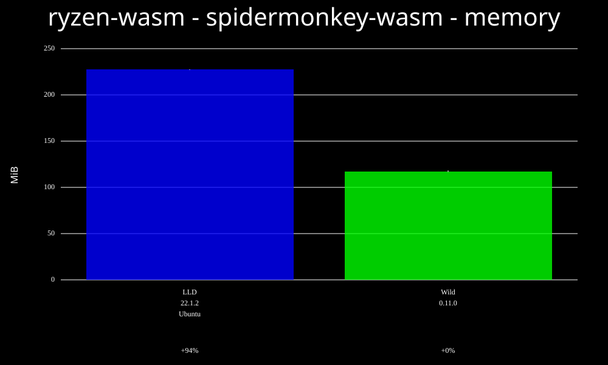

### wild-release-wasm - memory
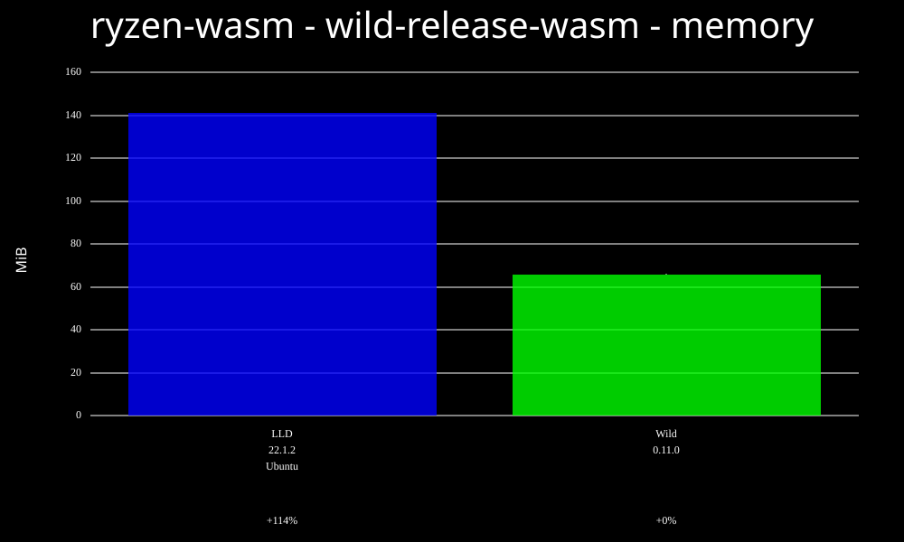

### cruby-wasm - memory
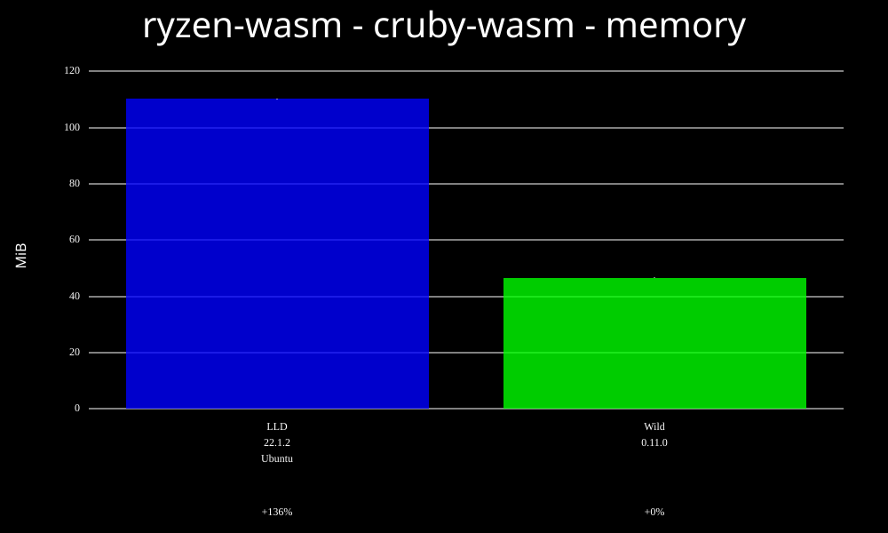

### cpython-wasm - memory
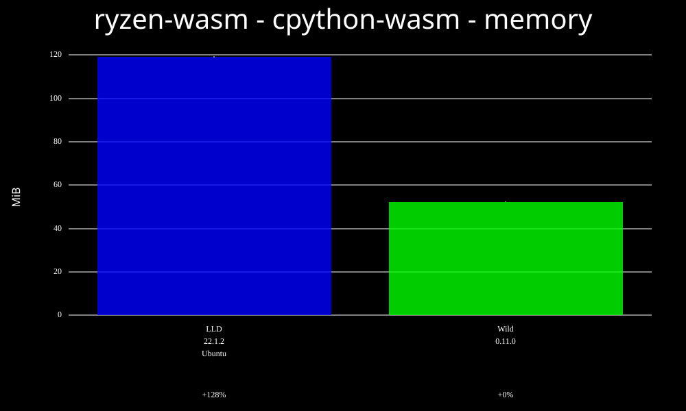

### sqlite-wasm - memory
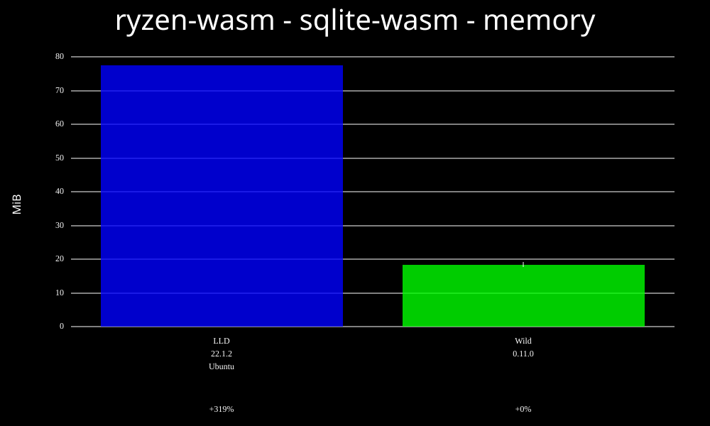

### spidermonkey-wasm.threads - memory
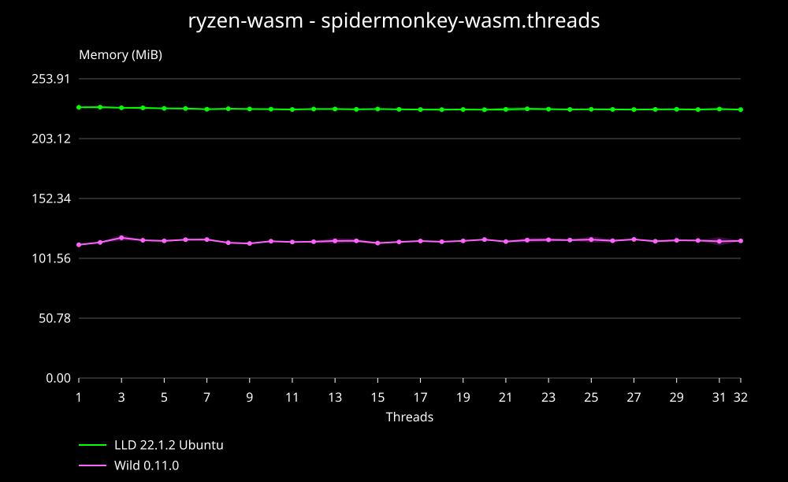

